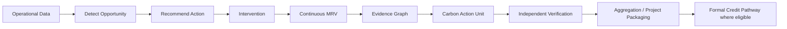
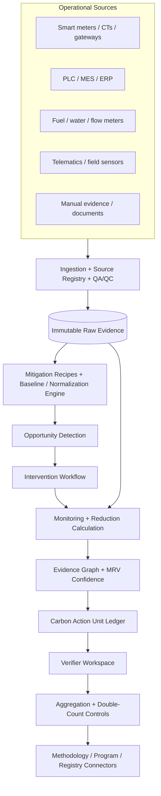

# Continuous MRV & Carbon Asset Engine

Turning everyday operational improvements into measurable, auditable and potentially credit-ready carbon outcomes

| MEASURE Primary operational data | DETECT Mitigation opportunities | PROVE Continuous MRV evidence | PACKAGE Carbon Action Units |
| --- | --- | --- | --- |

> **The central thesis**
> The next-generation carbon platform should not stop at calculating
emissions. It should continuously discover reduction opportunities, prove the improvement using trusted data, package each outcome as a traceable digital carbon asset, and aggregate eligible outcomes into formal carbon-credit projects when an approved methodology and verification pathway exist.

**Product · Device · MRV · Evidence · Verification · Assetization**

Technical concept document \| Version 1.0

# 1. Vision: From Carbon Accounting to Carbon Asset Creation

Most carbon platforms answer a backward-looking question: “How much did we emit?” The proposed system answers a more valuable forward-looking question: “What can we reduce today, can we prove it, and can the verified outcome become a usable carbon asset?”

> **Strategic shift**
> Move from carbon accounting to continuous carbon asset creation:
operational data → mitigation opportunity → intervention → MRV → evidence → verified outcome → aggregation → formal credit pathway.

## Design objectives

- Connect operational data instead of relying only on periodic manual
disclosures.

- Detect practical mitigation opportunities at machine, line, building,
fleet, farm or process level.

- Quantify reductions using transparent baselines, normalization rules
and versioned emission factors.

- Create an evidence trail strong enough for internal audit, customers,
verifiers and, where applicable, carbon-credit programs.

- Aggregate many small reductions so that small sites and SMEs can
participate in larger decarbonization programs.

## The “carbon mining” concept

The platform becomes a “carbon mining” engine: not mining tokens, but discovering verified emission reductions hidden inside everyday operations. The value exists even when no tradable credit is created, because the same workflow generates energy savings, compliance evidence, auditability, supplier proof and measurable decarbonization.

# 2. Carbon Action Units (CAUs)

A Carbon Action Unit is an internal digital record of a measured mitigation outcome. It is designed to be machine-readable, evidence-linked and auditable. It should never be presented as a formal carbon credit unless the relevant program or registry has completed its required process.

> **Integrity rule**
> 1 CAU can represent a defined quantity of measured CO₂e reduction
(for example 1 kgCO₂e), but “CAU” and “carbon credit” remain separate statuses. A formal carbon credit is only recognized after applicable methodology, additionality, validation/verification, program approval, issuance and tracking requirements are satisfied.

## CAU data model

| **Field**           | **Purpose**                                               |
|---------------------|-----------------------------------------------------------|
| CAU ID              | Unique immutable identifier                               |
| Facility / asset    | Where the mitigation occurred                             |
| Activity type       | e.g., compressor leak repair, HVAC optimization           |
| Baseline window     | Pre-intervention reference period                         |
| Monitoring window   | Post-intervention measured period                         |
| Baseline value      | Normalized expected consumption/emissions                 |
| Actual value        | Measured post-action value                                |
| Avoided emissions   | Calculated tCO₂e / kgCO₂e                                 |
| Methodology mapping | Potential applicable methodology / internal recipe        |
| Evidence links      | Telemetry, invoices, work orders, photos, calibration     |
| MRV confidence      | Quality score based on data and controls                  |
| Verification state  | Unverified / under review / verified / rejected           |
| Credit eligibility  | Not assessed / potential / eligible / registered / issued |
| Double-count state  | Clear / conflict / retired / exported                     |

## Illustrative CAU record

> CAU-IND-PLANT03-0001842 Activity: compressed-air leak reduction | Baseline: 118.2 kWh/h |
Actual: 94.1 kWh/h | Production-normalized saving: 14,280 kWh | Avoided emissions: calculated using a versioned factor | Telemetry coverage: 99.2% | Evidence: 46 records | Verification: pending | Credit eligibility: methodology-dependent.

# 3. End-to-End Continuous MRV Workflow

**1. Observe —** Stream operational data continuously or at an
appropriate frequency.

**2. Detect —** Identify abnormal consumption, inefficiencies or known
mitigation patterns.

**3. Recommend —** Generate an action with expected savings, required
evidence and monitoring period.

**4. Approve & act —** Record the intervention, responsible person, work
order and completion time.

**5. Establish baseline —** Select and lock the baseline model with
operating-condition normalization.

**6. Monitor actuals —** Collect post-intervention data and quality
indicators.

**7. Quantify —** Calculate avoided consumption and avoided emissions
with versioned factors.

**8. Prove —** Create the evidence graph, confidence score and audit
package.

**9. Verify —** Allow independent review, comments, acceptance or
rejection.

**10. Package / aggregate —** Create CAUs and group eligible units under
suitable projects or programs.

# 4. System Architecture

The architecture should keep raw evidence immutable, calculations reproducible and business logic versioned. A verifier must be able to trace any outcome back to the original measurements and rules used at the time.

## Data integrity and versioning

Raw device/enterprise data should be retained as source evidence. Derived values—normalized baselines, emission calculations, CAUs and scores—must reference the exact source records and rule versions used. Recalculation should create a new version rather than silently overwriting an earlier verified result.

# 5. Hardware & Telemetry Trust Layer

The hardware layer is not merely a data collector. It is the first trust anchor in the MRV chain. Where direct telemetry is available, each record should carry enough metadata to establish origin, time, quality and calibration context.

| **Domain**     | **Signals**                                      | **Typical source**                 |
|----------------|--------------------------------------------------|------------------------------------|
| Electrical     | kW, kWh, current, voltage, PF, demand, harmonics | Smart meter / CT / gateway         |
| Thermal        | Fuel flow, steam, hot-water energy, temperature  | Flow/temperature/energy meters     |
| Water          | Volume, pump energy, pressure                    | Water meter + electrical telemetry |
| Compressed air | Compressor kWh, pressure, flow, runtime          | Meter + pressure/flow sensor       |
| Production     | Units, batch mass, machine state                 | PLC/MES/ERP/API                    |
| Fleet          | Distance, fuel, idle time, route                 | OBD/telematics/GPS                 |
| Waste          | Weight, category, destination                    | Scale + workflow evidence          |
| Agriculture    | Water depth, irrigation events, pump energy      | Field sensor + gateway             |

## Minimum telemetry envelope

- device_id / source_id
- asset_id / facility_id
- timestamp + timezone
- metric + unit
- raw value
- quality flag
- calibration/version metadata
- ingestion timestamp
- optional signature/hash
- network/offline buffering status

# 6. Mitigation Recipe Library

A mitigation recipe is a reusable digital playbook. It tells the platform what pattern to look for, what action is expected, how to create the baseline, what evidence is mandatory and how to monitor persistence.

| **Recipe**   | **Opportunity**               | **Required data**                   | **Evidence**                          |
|--------------|-------------------------------|-------------------------------------|---------------------------------------|
| MR-EE-001    | Compressed-air leak reduction | Compressor kWh + pressure + runtime | Repair event + before/after telemetry |
| MR-HVAC-002  | HVAC schedule optimization    | HVAC kWh + temperature + occupancy  | Schedule change + comfort limits      |
| MR-MOTOR-003 | Idle motor elimination        | Current signature + machine state   | Control change / shutdown rule        |
| MR-BOIL-004  | Boiler efficiency improvement | Fuel + steam output                 | Tune-up / insulation / O₂ settings    |
| MR-SOLAR-005 | Solar self-consumption        | Generation + grid import            | Commissioning + inverter data         |
| MR-FLEET-006 | Vehicle idling reduction      | Fuel + GPS + engine state           | Driver/process intervention           |
| MR-WASTE-007 | Organic waste diversion       | Waste mass + destination            | Manifest / receiving evidence         |
| MR-AGRI-008  | Water-management practice     | Field water level + irrigation      | Practice compliance evidence          |

> **Why recipes matter**
> They make carbon expertise executable. Instead of starting every
project from a blank consultancy engagement, the platform can detect, explain, measure and audit a known mitigation pattern consistently.

# 7. Carbon Opportunity Radar

The enterprise dashboard should show a live pipeline of potential and realized decarbonization rather than a static emissions inventory.

| 1,842 t Potential annual reduction | 486 t Mitigation achieved | 302 t Verified mitigation | 211 t Potentially credit-ready |
| --- | --- | --- | --- |

## Opportunity pipeline

**Detected → Recommended → Approved → Implemented → Monitoring → Verified → Credit-ready → Registered → Issued → Retired**

## Questions every opportunity should answer

- What was detected?
- How much CO₂e and operating cost could be reduced?
- What action is recommended?
- What sensors/data are already available?
- What evidence is missing?
- How long must the action be monitored?
- What is the confidence level?
- Could an approved methodology apply?
- What would prevent double counting?

# 8. Carbon Evidence Graph

A number such as “10 tCO₂e saved” is not enough. The platform should store the relationships that explain why the number can be trusted.

> **Evidence chain**
> Device → Asset → Production/Activity → Energy/Fuel/Material →
Baseline → Intervention → Monitoring → Calculation → Mitigation Outcome → Verifier → Methodology → Carbon Asset → Registry/Retirement state

This graph makes every claim traceable. Clicking a CAU should allow an auditor to move backward from the final result to each source measurement, formula, emission factor, work order and verification decision.

## Evidence object types

| **Object**          | **Examples**                                                |
|---------------------|-------------------------------------------------------------|
| Measurement         | meter reading, flow record, GPS point, water-depth reading  |
| Operational context | batch, production units, occupancy, machine state           |
| Intervention        | maintenance order, control change, equipment replacement    |
| Document            | invoice, calibration certificate, manifest, photograph      |
| Rule                | baseline model, emission factor, methodology version        |
| Review              | verifier comment, approval, rejection, corrective action    |
| Asset state         | CAU creation, aggregation, export, retirement, cancellation |

# 9. MRV Confidence Score

A transparent quality score can help prioritize opportunities and communicate evidence strength. It is an internal decision-support metric, not a substitute for third-party verification or registry approval.

| **Dimension**                     | **Weight** |
|-----------------------------------|------------|
| Sensor/primary-data coverage      | 20         |
| Data completeness & continuity    | 15         |
| Calibration / source quality      | 10         |
| Baseline robustness               | 15         |
| Additionality evidence            | 15         |
| Methodology alignment             | 10         |
| Evidence integrity / auditability | 5          |
| Independent verification          | 10         |

> **Score interpretation**
> 90–100: audit-ready evidence; 75–89: strong but gaps remain; 50–74:
indicative; <50: insufficient for a high-confidence claim. Thresholds are configurable by use case.

# 10. Carbon Asset Wallet

The wallet should distinguish corporate emissions, mitigation achieved, verified mitigation, internal CAUs and formal issued credits. This prevents marketing claims from getting ahead of evidence.

| **Ledger**              | **Meaning**                                             |
|-------------------------|---------------------------------------------------------|
| Gross emissions         | Measured/calculated organizational or product emissions |
| Mitigation achieved     | Quantified improvements after intervention              |
| Verified mitigation     | Outcomes accepted through defined review                |
| CAUs                    | Internal evidence-linked carbon action records          |
| Registry credits issued | Formal credits issued by an applicable program          |
| Credits retired         | Units permanently used/retired                          |
| Available balance       | Only the relevant unretired asset class                 |

# 11. Aggregation Engine

Many individual sites generate reductions too small to justify a standalone carbon project. The platform can create value by standardizing MRV and aggregating compatible outcomes into larger programs—subject to the rules of the chosen methodology and crediting program.

> **Illustrative aggregation**
> 500 small facilities × 35 tCO₂e/year measured reduction = 17,500
tCO₂e/year of aggregated mitigation potential. The platform’s role is to standardize data, evidence, QA/QC, monitoring and project packaging; formal issuance remains subject to the governing program.

## Aggregation controls

- Same or compatible methodology
- Consistent baseline and monitoring rules
- Unique facility/activity identities
- No duplicate CAU assignment
- Common QA/QC thresholds
- Versioned project boundaries
- Verifier sampling and review support
- Clear ownership and retirement rules

# 12. Sector Opportunity Matrix

| **Sector**           | **High-value actions**                               | **MRV angle**                                 |
|----------------------|------------------------------------------------------|-----------------------------------------------|
| Manufacturing        | Motors, compressed air, process heat, fuel switching | Direct telemetry; strong automation potential |
| Commercial buildings | HVAC, lighting, pumps, hot water                     | BMS + submeter + occupancy normalization      |
| Warehouses / retail  | Cooling, refrigeration, lighting                     | Repeatable multi-site recipes                 |
| Fleet / logistics    | Idling, routing, fuel/EV efficiency                  | Telematics + operational context              |
| Waste                | Diversion, recycling, methane avoidance              | Mass balance + chain-of-custody evidence      |
| Agriculture          | Irrigation / water management, pump energy           | Field sensors + practice evidence             |
| Supply chain         | Supplier reduction programs                          | Shared evidence + product/batch linkage       |

# 13. Industrial Example: Compressed-Air Leak Reduction

Scenario: a compressor shows a stable overnight load inconsistent with production. The system creates an opportunity rather than merely reporting higher electricity consumption.

1.  Detection: energy signature indicates avoidable base load.
2.  Recommendation: inspect compressed-air leaks and automatic shutdown
logic.

3.  Action: repair work order completed and intervention timestamp
recorded.

4.  Baseline: expected compressor consumption normalized for
runtime/production.

5.  Monitoring: post-intervention period confirms lower consumption
under comparable conditions.

6.  Quantification: avoided kWh × approved/versioned emission factor.
7.  Evidence: telemetry, work order, technician record, calibration and
calculation version.

8.  Outcome: CAU created, confidence scored and routed for verification.
9.  Eligibility: methodology engine assesses whether it can be included
in a formal program.

# 14. AI Mitigation Agent

An autonomous software agent can continuously analyze energy, production, fuel, waste, water, fleet and operational data, then present a prioritized list of actions—not autonomous financial claims.

> **Daily agent briefing**
> “7 opportunities identified. Estimated annual reduction: 128 tCO₂e.
Three can be measured automatically. Two appear methodology-compatible. Two require human review. Missing evidence: maintenance record and calibration certificate.”

## Agent capabilities

- Detect anomalies and mitigation patterns
- Estimate savings ranges
- Select relevant recipe
- Check data sufficiency
- Request missing evidence
- Propose baseline window/model
- Monitor persistence after intervention
- Flag rebound or reversal
- Route eligible outcomes to verifier/project workflow

# 15. Verification, Governance & Claims Controls

The system should separate operator, platform and verifier responsibilities. A verifier must not be able to modify underlying source data; an operator must not be able to self-approve a verified result.

| **Role**         | **Can do**                                                         | **Cannot do**                                    |
|------------------|--------------------------------------------------------------------|--------------------------------------------------|
| Company operator | Connect data, create actions, upload evidence, respond to findings | Approve its own independent verification         |
| Platform engine  | Calculate, score, flag, version, route workflows                   | Declare formal registry issuance by itself       |
| Verifier         | Review evidence, request corrections, approve/reject outcome       | Alter raw telemetry                              |
| Program/registry | Apply program rules, issue/track credits where applicable          | Rely on internal CAU label as automatic issuance |
| Public viewer    | See approved claims and provenance summary                         | Access confidential raw enterprise data          |

## Governance controls

- Freeze verified calculation versions.
- Maintain revocation/cancellation state.
- Record verifier identity, decision and timestamp.
- Prevent the same mitigation outcome from being counted in multiple
projects.

- Separate “avoided emissions”, “verified mitigation”, “credit-ready”
and “issued credit” labels.

- Retain provenance for emission-factor and methodology versions.

# 16. Core Data Model

| **Entity**          | **Core relationships**                               |
|---------------------|------------------------------------------------------|
| Organization        | owns facilities, users, projects                     |
| Facility            | contains assets/meters; emits operational data       |
| Asset               | linked to meters, processes and recipes              |
| Measurement         | source → asset → timestamp → metric                  |
| Baseline            | asset/activity → model version → input window        |
| Opportunity         | recipe → asset → estimated impact → status           |
| Intervention        | opportunity → action → evidence → completion         |
| Calculation         | baseline + actuals + factor + rule version           |
| Evidence            | file/record/hash → object linkage                    |
| CAU                 | calculation → evidence graph → verification state    |
| Verification        | CAU/project → reviewer → findings/decision           |
| Project/Aggregation | groups eligible CAUs under defined boundary          |
| Registry record     | external project/unit/issuance/retirement references |

# 17. Event & API Architecture

A clean event-driven interface allows devices, enterprise systems and future registry integrations to evolve independently.

| **Event / endpoint**    | **Purpose**                                  |
|-------------------------|----------------------------------------------|
| measurement.ingested    | New telemetry accepted with quality metadata |
| quality.flagged         | Missing/invalid/stale source detected        |
| opportunity.detected    | Mitigation pattern discovered                |
| intervention.completed  | Operational action finished                  |
| baseline.locked         | Reference model version frozen               |
| mrv.window.completed    | Monitoring window reached                    |
| calculation.created     | Avoided emissions result versioned           |
| cau.created             | Internal carbon action record created        |
| verification.requested  | Evidence package sent for review             |
| verification.decided    | Approve/reject with findings                 |
| project.aggregated      | CAUs linked into an aggregation boundary     |
| registry.status.updated | External status synchronized                 |

# 18. MVP Scope

The first release should prove one narrow, high-confidence loop end to end rather than attempt every carbon market and sector.

> **Recommended MVP**
> Industrial energy efficiency: one facility, 3–5 electrical assets,
live/near-live telemetry, three mitigation recipes, baseline engine, before/after MRV, evidence graph, CAU creation, verifier review and audit export.

## MVP backlog

- Device/source registry with calibration metadata
- Telemetry ingestion + data-quality dashboard
- Asset hierarchy and meter mapping
- Three mitigation recipes
- Opportunity detection rules
- Intervention workflow
- Baseline and normalization engine
- Versioned emission-factor service
- Evidence attachment/linking
- CAU generator
- MRV confidence score
- Verifier workspace
- Audit export (PDF/CSV/JSON)
- Carbon opportunity pipeline dashboard

## What not to do in the first release

Avoid launching with a public token, marketplace, price speculation, dozens of methodologies or automatic registry claims. First prove that the system can detect a real intervention, quantify a defensible reduction and produce an evidence package an independent reviewer can understand.

# 19. Phased Roadmap

| **Phase**                    | **Indicative timing** | **Primary outcome**                                                                                               |
|------------------------------|-----------------------|-------------------------------------------------------------------------------------------------------------------|
| Phase 1 — Instrument & Trust | 0–3 months            | Telemetry, source registry, asset mapping, QA/QC, immutable raw evidence                                          |
| Phase 2 — Detect & Measure   | 3–6 months            | Mitigation recipes, opportunity radar, interventions, baseline/actual engine                                      |
| Phase 3 — Prove & Verify     | 6–9 months            | Evidence graph, confidence score, verifier workflow, audit package                                                |
| Phase 4 — Aggregate          | 9–12 months           | CAU ledger, project grouping, double-count controls, portfolio analytics                                          |
| Phase 5 — Connect Programs   | 12+ months            | Methodology-specific project templates, validation/verification connectors, registry integrations where available |

# 20. Success Metrics

| **Metric**                                | **Why it matters**                    |
|-------------------------------------------|---------------------------------------|
| % telemetry trusted                       | Measures source quality               |
| % opportunities auto-detected             | Shows automation value                |
| % opportunities implemented               | Connects analytics to action          |
| tCO₂e mitigated                           | Core climate outcome                  |
| ₹/\$ operating savings                    | Commercial ROI independent of credits |
| % CAUs independently verified             | Evidence quality                      |
| Average evidence completeness             | Audit readiness                       |
| Time from intervention → verified outcome | Operational efficiency                |
| Reversal/rebound rate                     | Persistence                           |
| Double-count incidents                    | Must remain zero                      |

# 21. Engineering Principles

- Evidence first, claims second.
- Never overwrite a verified calculation—version it.
- Make every number traceable to its source.
- Treat methodologies as configurable rule packs, not hard-coded
assumptions.

- Keep carbon-credit status separate from internal mitigation status.
- Support manual evidence, but clearly grade it below trusted primary
telemetry where appropriate.

- Design for aggregation from day one: unique identities, boundaries,
ownership and double-count protection.

- Make savings useful even without carbon credits: energy, cost,
compliance and operational efficiency.

# 22. Product Positioning

**The platform should be described as a Continuous MRV and Carbon Asset Operating System—not simply a carbon calculator or ESG dashboard.**

> **One-sentence proposition**
> Connect operational data, discover mitigation opportunities, measure
the improvement continuously, build audit-grade evidence and convert eligible verified outcomes into credit-ready carbon assets.

> **Memorable positioning**
> Companies already have carbon data. The opportunity is to turn
operational improvement into provable decarbonization—and provable decarbonization into a managed asset.

## Implementation workshop: immediate next steps

**1.** Select 3 industrial mitigation recipes for the first pilot.

**2.** Confirm meter/gateway signals and sampling frequency.

**3.** Define telemetry envelope and device trust metadata.

**4.** Agree baseline/normalization strategy for each recipe.

**5.** Design CAU JSON schema and evidence graph IDs.

**6.** Create verifier screen and immutable verification state.

**7.** Define audit export format.

**8.** Run one live before/after intervention and measure the full
workflow.

**MEASURE → DETECT → ACT → PROVE → VERIFY → PACKAGE → AGGREGATE**

A practical blueprint for making day-to-day decarbonization measurable and investable.